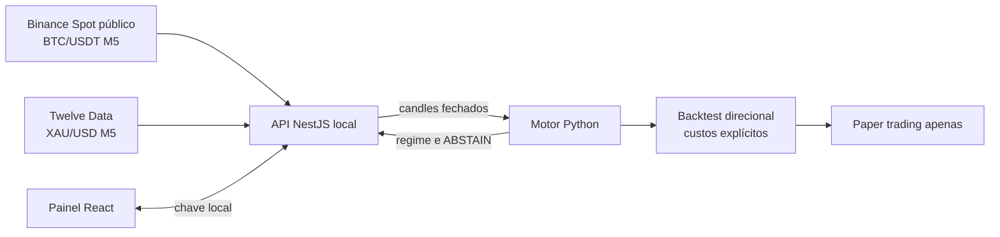

# Market Intelligence Lab

Plataforma local de pesquisa quantitativa para **BTC/USDT** e **XAU/USD (ouro)**. O projeto recebe candles de fontes documentadas, valida qualidade, calcula indicadores e regimes, permite backtests com custos explícitos e mantém qualquer execução real bloqueada.

> Projeto educacional e de portfólio. Não envia ordens, não recomenda operações e não promete rentabilidade.

## Escopo atual

| Ativo | Fonte | Uso | Limite importante |
|---|---|---|---|
| `BTCUSDT` | Binance Spot, leitura pública | Candles M5 para análise local | É o preço BTC/USDT daquela exchange, não um preço consolidado nem uma cotação de execução. |
| `XAUUSD` | Twelve Data, com chave de API | Candles M5 de referência | A cotação não inclui spread, financiamento ou a execução da corretora escolhida. |

O painel aceita somente `BTCUSDT` ou `XAUUSD`. A análise permanece `ABSTAIN` até existir evidência auditável de um modelo aprovado. O módulo direcional novo calcula retorno **líquido de custos informados**, mas serve apenas para backtest e paper trading.

## O que mudou

- A interface e a API agora trabalham com BTC/USDT e XAU/USD em vez de contratos binários.
- BTC/USDT vem do endpoint público de candles da Binance; ouro usa Twelve Data quando `TWELVE_DATA_API_KEY` estiver configurada.
- Foi incluído um baseline direcional EMA para `long`, `short` e `flat`, com spread, slippage, comissão e financiamento declarados em pontos-base.
- A execução real segue bloqueada por configuração e por código.
- A pesquisa anterior de opções binárias continua no histórico do Git como estudo de viabilidade negativa; ela não é base para sinais de Forex ou cripto.

## Arquitetura



## Dados e custos

A fonte de dados e o lugar onde alguém executaria uma ordem podem divergir. Por isso o sistema nunca chama um candle de preço de execução. Para cada backtest direcional, informe custos de ida e volta:

- `spread_bps`
- `slippage_bps`
- `commission_bps`
- `financing_bps`

Sem custos fornecidos, os valores são zero por segurança de interpretação: isso significa **não informado**, não “sem custo”. O resultado não pode ser usado para estimar lucro real até que o histórico de custos da conta e do instrumento esteja disponível.

Detalhes e fontes: [FOREX_CRYPTO_RESEARCH.md](docs/FOREX_CRYPTO_RESEARCH.md).

## Rodar no Windows PowerShell

Requisitos: Python 3.11+, Node.js 20+ e npm.

### Motor e testes

```powershell
cd services/ai-engine
py -3.11 -m venv .venv
.\.venv\Scripts\python.exe -m pip install -e ".[dev,research]"
.\.venv\Scripts\python.exe -m pytest
```

### Painel local

Gere uma vez dois segredos longos no PowerShell e mantenha os mesmos valores nos terminais:

```powershell
$env:API_KEY = -join ((1..48) | ForEach-Object { [char](Get-Random -Minimum 65 -Maximum 91) })
$env:ENGINE_TOKEN = -join ((1..48) | ForEach-Object { [char](Get-Random -Minimum 65 -Maximum 91) })
```

Para analisar ouro, acrescente uma chave da Twelve Data somente no terminal da API:

```powershell
$env:TWELVE_DATA_API_KEY = 'sua-chave-da-twelve-data'
```

Terminal 1:

```powershell
cd services/ai-engine
.\.venv\Scripts\python.exe -m binary_intelligence_ai.service
```

Terminal 2:

```powershell
cd apps/api
npm ci
npm run build
npm run start
```

Terminal 3:

```powershell
cd apps/dashboard
npm ci
npm run dev
```

Abra `http://127.0.0.1:5173`, informe a chave local e escolha `BTCUSDT` ou `XAUUSD`.

## Documentação

| Documento | Conteúdo |
|---|---|
| [FOREX_CRYPTO_RESEARCH.md](docs/FOREX_CRYPTO_RESEARCH.md) | Fontes de dados, limites e modelo de custos para ouro e BTC |
| [DATA_CONTRACTS.md](docs/DATA_CONTRACTS.md) | Candles, qualidade e persistência |
| [MARKET_ANALYSIS.md](docs/MARKET_ANALYSIS.md) | Indicadores e regimes sem vazamento temporal |
| [BACKTESTING.md](docs/BACKTESTING.md) | Walk-forward e limites do backtest binário histórico |
| [SECURITY_AND_AUTOMATION_REVIEW.md](docs/SECURITY_AND_AUTOMATION_REVIEW.md) | Execução real bloqueada |

## Limites atuais

- Não há corretora conectada, conta real, adaptador de execução, alavancagem nem envio de ordens.
- Não existe modelo promovido nem evidência de vantagem estatística para BTC ou ouro.
- A análise usa candles fechados e sempre devolve `ABSTAIN` nesta versão.
- Ouro exige uma chave da Twelve Data; sem ela, a API explica a indisponibilidade em vez de usar dados inventados.
