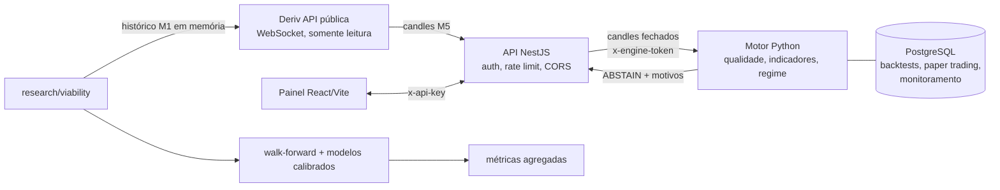

# Binary Intelligence AI

**Uma IA consegue prever opções binárias de curto prazo? Este projeto testou essa hipótese com rigor de engenharia e dados reais. A resposta foi não, e o repositório mostra como chegar a essa conclusão sem se enganar.**

Plataforma completa de pesquisa quantitativa: motor de machine learning em Python, backtesting walk-forward sem vazamento temporal, API NestJS, painel React, PostgreSQL e um teste de viabilidade com dados públicos reais da Deriv. A execução de ordens reais é bloqueada por código.

> **English summary.** A full-stack quantitative research platform (Python ML engine, walk-forward backtesting, NestJS API, React dashboard, PostgreSQL) built to test whether ML can predict short-term binary options. Using 60 days of real public market data, calibrated models (logistic regression, random forest, gradient boosting) scored ~50% accuracy against a 53–57% break-even, across horizons from 15 min to 4 h, news filters, rolling retraining and confidence thresholds. A synthetic random index served as a negative control. Conclusion: no exploitable edge; real trading stays disabled by design.

> Projeto de estudo. Não é recomendação de investimento.

## Resultado em 30 segundos

Para lucrar com payout de 76% a 96%, é preciso acertar entre **51% e 57%** das operações. Previsões sempre fora da amostra:

| Teste | Previsões avaliadas | Acerto necessário | Melhor acerto | Resultado |
|---|---|---|---|---|
| Controle: índice sintético aleatório `R_100`, 5 min | 38.190 | 51,0% | 50,5% | todos negativos (como esperado) |
| EUR/USD, 15 min, **4 dias** | 374 | 54,9% | **62,8%** | parecia vantagem... |
| EUR/USD, 15 min, **60 dias** | 55.616 | 53,5% | 51,8% | ...que desapareceu |
| EUR/USD, 30 min / 60 min / 4 h, sem horários de notícia | 16–38 mil | 55–57% | 48–49% | todos negativos |
| EUR/USD, 15 min, retreino só com os últimos 5 dias | 40.959 | 56,8% | 50,6% | todos negativos |
| Somente entradas de alta confiança | centenas a milhares | 55–57% | 54,4% | nenhuma acima do break-even |

Principais aprendizados:

- **Amostra pequena engana.** 62,8% de acerto em 4 dias virou 51,8% em 60 dias.
- **O controle negativo funciona.** No índice sintético, que é aleatório por construção, o procedimento não gerou falso positivo. Então o "não" para o EUR/USD é confiável.
- **Mais IA não cria sinal.** Retreino contínuo, filtro de notícias, prazos longos e seleção por confiança não mudaram o resultado. Nos prazos de 30 e 60 min, as entradas mais confiantes acertaram *menos* (38–43%).
- **A premissa do produto não existia.** A Deriv não oferece EUR/USD de 5 minutos; o prazo mínimo é 15 minutos.

Detalhes e limitações: [docs/VIABILITY_TEST.md](docs/VIABILITY_TEST.md).

## O que este projeto demonstra

**Validação estatística honesta**
- Features calculadas só com candles fechados, com teste automatizado de ausência de vazamento temporal.
- Walk-forward com *gap* igual ao horizonte; calibração de Platt em período separado; holdout identificado por SHA-256.
- Critérios de promoção versionados: ≥300 observações, melhora de Brier, log loss, erro de calibração ≤ 0,08, vitória em ≥60% dos folds e intervalo de confiança do acerto acima do break-even.
- Controle negativo, alerta de múltiplos testes e sobreposição de rótulos documentados.

**Segurança por padrão**
- Decisão padrão `ABSTAIN`; a API rejeita qualquer resposta do motor que não seja abstenção.
- Execução real bloqueada em código e na inicialização (`EXECUTION_MODE`, `REAL_EXECUTION_ENABLED`).
- API e motor só no loopback, chaves de 32+ caracteres comparadas em tempo constante, Helmet, CORS restrito, rate limit e limites de payload.
- Parada de emergência travada, risco independente do modelo e paper trading idempotente.

**Respeito a direitos de dados**
- Os termos da Deriv limitam o cache a 24 h, então o teste de viabilidade processa tudo **em memória** e só emite métricas agregadas.
- O filtro de notícias usa horários de divulgação conhecidos de antemão, e não volatilidade observada, que seria informação futura.

## Arquitetura



| Camada | Tecnologia |
|---|---|
| Motor quantitativo | Python 3.11, pandas, NumPy, scikit-learn, Pydantic, SQLAlchemy |
| API | NestJS 11, TypeScript, Helmet, `ws` |
| Painel | React 19, Vite 7 |
| Dados | PostgreSQL 17 (Docker Compose), esquemas JSON versionados |
| Testes | pytest (87 testes), validação de esquemas, teste integrado com PostgreSQL |

## Estrutura

```
services/ai-engine/   motor Python: dados, features, regimes, modelos, backtesting,
                      risco, paper trading, monitoramento, serviço HTTP e pesquisa
apps/api/             API NestJS (controle, consultas, ponte com motor e Deriv)
apps/dashboard/       painel React
packages/contracts/   esquemas JSON versionados entre os serviços
infrastructure/       Docker Compose e migrações PostgreSQL
docs/                 decisões, metodologia e resultados de cada fase
```

## Como rodar

Requisitos: Python 3.11+, Node.js 20+ e npm. Comandos para PowerShell no Windows.

**Motor e testes**

```powershell
cd services/ai-engine
py -3.11 -m venv .venv
.\.venv\Scripts\python.exe -m pip install -e ".[dev,research]"
.\.venv\Scripts\python.exe -m pytest
.\.venv\Scripts\python.exe -m binary_intelligence_ai.models.demo
```

Se `py -3.11` não estiver disponível, use `python` após conferir `python --version`.

**Teste de viabilidade com dados reais (em memória)**

```powershell
.\.venv\Scripts\python.exe -m binary_intelligence_ai.research.viability --symbol frxEURUSD --horizons 15,60 --days 60 --exclude-news
```

**Plataforma completa (motor + API + painel)**

São três terminais com o mesmo `API_KEY` e `ENGINE_TOKEN` (32+ caracteres aleatórios). O passo a passo está em [docs/API_AND_DASHBOARD.md](docs/API_AND_DASHBOARD.md). Com tudo no ar, abra `http://127.0.0.1:5173`, informe a chave e analise um símbolo como `frxEURUSD`.

**PostgreSQL opcional**

```powershell
cd infrastructure
docker compose up -d
```

As migrações de `postgres/` são aplicadas na primeira criação do volume. Os testes unitários não exigem Docker; o teste integrado exige a URL do PostgreSQL.

## Documentação

| Documento | Conteúdo |
|---|---|
| [VIABILITY_TEST.md](docs/VIABILITY_TEST.md) | Teste com dados reais, resultados e limitações |
| [PLATFORM_RESEARCH.md](docs/PLATFORM_RESEARCH.md) | Pesquisa de corretoras e provedores de dados |
| [DATA_CONTRACTS.md](docs/DATA_CONTRACTS.md) | Contratos, validação de qualidade e persistência |
| [MARKET_ANALYSIS.md](docs/MARKET_ANALYSIS.md) | Indicadores e classificação de regimes |
| [BACKTESTING.md](docs/BACKTESTING.md) | Walk-forward, rótulos de liquidação e métricas |
| [ML_MODELS.md](docs/ML_MODELS.md) | Modelos, calibração e critérios de promoção |
| [NEWS_CONTEXT.md](docs/NEWS_CONTEXT.md) | Contexto de notícias e janelas de bloqueio |
| [PAPER_TRADING_AND_RISK.md](docs/PAPER_TRADING_AND_RISK.md) | Decisão determinística e controles de risco |
| [API_AND_DASHBOARD.md](docs/API_AND_DASHBOARD.md) | Endpoints, painel e execução local |
| [OPERATIONS_AND_MONITORING.md](docs/OPERATIONS_AND_MONITORING.md) | Registro de modelos, drift, rollback e runbook |
| [DERIV_INTEGRATION_EVALUATION.md](docs/DERIV_INTEGRATION_EVALUATION.md) | Avaliação da integração oficial |
| [SECURITY_AND_AUTOMATION_REVIEW.md](docs/SECURITY_AND_AUTOMATION_REVIEW.md) | Revisão de segurança e decisão GO/NO-GO |

## Roteiro

1. Pesquisa de plataformas e direitos de dados
2. Estrutura e ambientes
3. Contratos, validação e persistência
4. Indicadores e regimes sem vazamento temporal
5. Baselines e backtesting walk-forward
6. Modelos tabulares calibrados
7. Contexto de notícias auditável
8. Paper trading e risco independente
9. API autenticada e painel
10. Monitoramento, holdout e rollback
11. Avaliação da integração oficial (execução real bloqueada)
12. Revisão de segurança: automação real **NO-GO**
13. Teste de viabilidade com dados reais: **sem vantagem estatística**

## Limitações

- A liquidação é aproximada pelo fechamento de candles M1, não pelos ticks exatos do contrato.
- O payout usado é uma fotografia da cotação; ele varia ao longo do dia.
- Só o conjunto de features técnicas `technical-v1` foi testado; outra abordagem exige a mesma avaliação, com holdout intocado.
- O estado da API fica em memória e não há reconciliação contínua com o PostgreSQL.
